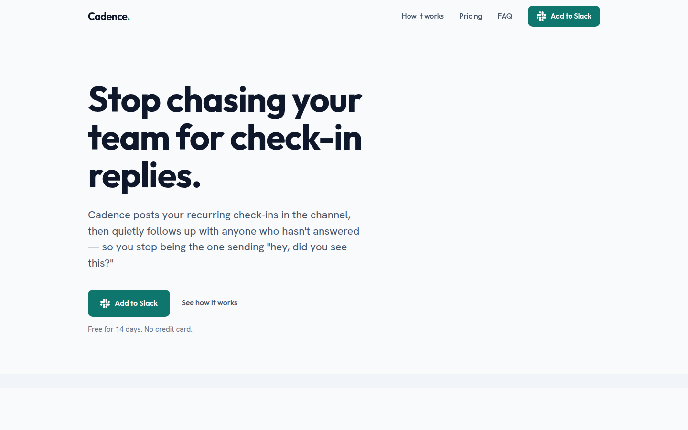
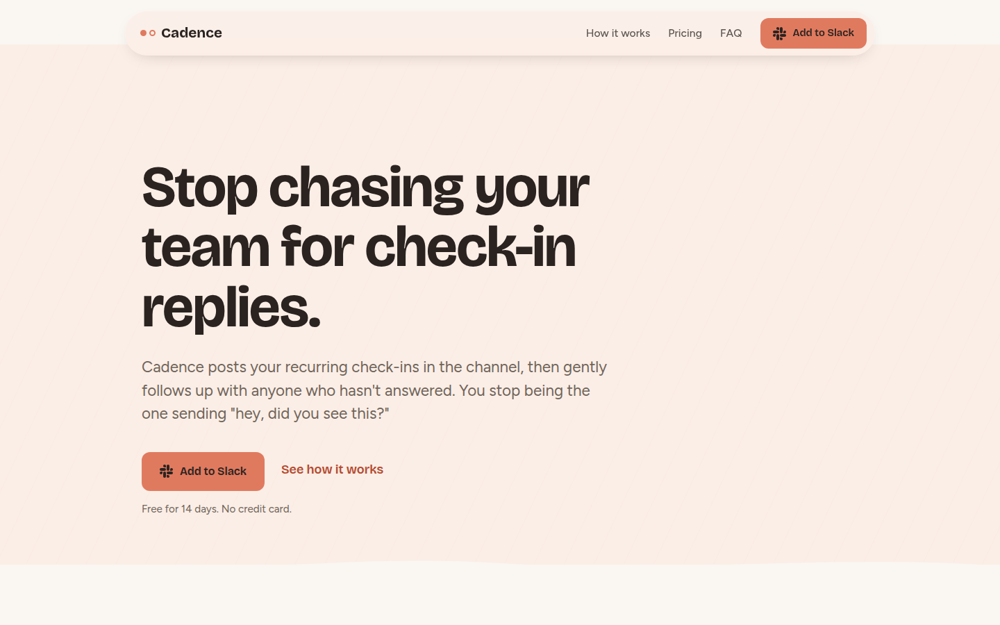

# Deft

**Landing pages from AI coding agents that don't look like every other AI landing page.**

Deft is an open-source skill system for AI coding agents (Claude Code, Codex, Cursor, Windsurf, or anything that reads a project instructions file). It makes the agent understand your product before it designs anything, commit to a real design idea before it writes code, and hold the result to copy, design, accessibility and conversion standards before the page ships.

No packages, no build step, no runtime. Deft is a set of Markdown files your agent reads on demand.

Site: [deftskill.pages.dev](https://deftskill.pages.dev), built with Deft itself. The full brief, concept and preflight log are in [`site/BRIEF.md`](site/BRIEF.md).

| First test run (v0.1) | Same brief after Patches 001 + 002 |
|---|---|
|  |  |

Both pages come from the same brief for "Cadence", a Slack check-in tool. The left one broke no rules and still looked like every other SaaS page. Fixing that gap is what the current version of Deft is about. Source: [`examples/cadence/`](examples/cadence/).

---

## Contents

- [Why Deft exists](#why-deft-exists)
- [How it works](#how-it-works)
- [Installation](#installation)
- [Usage](#usage)
- [What you can expect in a session](#what-you-can-expect-in-a-session)
- [The rules, at a glance](#the-rules-at-a-glance)
- [Project structure](#project-structure)
- [Design philosophy](#design-philosophy)
- [Page types](#page-types)
- [Who Deft is for](#who-deft-is-for)
- [Roadmap](#roadmap)
- [Contributing](#contributing)
- [License](#license)

---

## Why Deft exists

Ask any AI agent for a landing page and you get the same page: a purple gradient, "Unlock your potential", three feature cards, and a testimonial nobody said. The model isn't the problem. It has no idea what your product is, who it's for, or what good looks like, so it falls back to the average of everything it has seen.

Deft gives the agent the three things it's missing:

1. **Context.** A short interview that turns your answers into a structured brief.
2. **Rules.** Banned phrases, banned visual defaults, and the reasoning behind each so the agent can handle cases no rule anticipated.
3. **A quality gate.** Numbered preflight checks the page has to pass before it's handed back to you.

There's a fourth thing, learned the hard way. Bans alone produce pages that comply but have no character. The agent picks the nearest safe default for every choice, and every page of the same tone ends up looking like a sibling. So Deft also requires a **design concept**: one committed visual direction and one idea a competitor's page couldn't reuse. See the [Changelog](CHANGELOG.md) for the full story.

> A page that violates no rules but has no idea is still a failed page. Rules are the floor, not the finish line.

---

## How it works

The agent moves through five stages in order. It cannot skip one, and it cannot write page code until the brief and the design concept are approved.

```
 Interview  ──▶  Copy  ──▶  Design Concept  ──▶  Build  ──▶  Preflight
 (brief)        (section     (direction +        (section      (numbered
                 by section)  One Idea)           by section)   checks)
   ✔ approve      ✔ approve    ✔ approve                       ✔ approve
```

### 1. Interview → the brief

The agent asks one or two questions at a time, gives the reason in one line, and offers options instead of open-ended prompts. It reads like a conversation with a strategist, not a form.

**Must ask:** what you're building (intent), what the product does in one sentence, the one reader it's for, where traffic comes from, and why this instead of the alternatives.
**Should ask:** tone, social proof you actually have, existing brand assets.
**Infers if not offered:** everything else, and it tells you what it assumed.

Once the page type is known, the agent loads the matching flow from `flows/`, which adds type-specific questions and a default section order. If you answer "I don't know", the agent proposes a sensible default and moves on instead of stalling.

The output is a brief you approve. Right after that, the agent offers a short menu of optional distinctive touches (scroll feel, hero entrance, cursor, section transitions). Sensible defaults apply whether you engage or not.

### 2. Copy

The agent restates the brief in one paragraph so it doesn't drift, then writes copy section by section, each one approved before the next.

- Traffic source sets the direction: cold paid traffic gets problem-first copy, warm referral traffic gets solution-first.
- Every line passes a replacement ladder and a specificity test. "Revolutionize your workflow" becomes "cuts onboarding from 3 weeks to 3 hours."
- A [banned-phrase list](skills/deft/copy/BANNED-PHRASES.md) blocks the stock vocabulary that makes AI copy recognizable, plus [industry-specific slop](skills/deft/copy/INDUSTRY-SLOP.md).
- Zero em dashes. Not a budget of one. Zero.

### 3. Design Concept (the gate)

Before any code, the agent presents a concept for approval:

- **One direction** from the [exemplar library](skills/deft/aesthetic/DIRECTIONS.md), with its exact palette values. Never a blend, never an unmodified Tailwind ramp.
- **The One Idea:** a visual concept tied to this product that no competitor's page could reuse.
- **Typography** with a product-specific reason, plus one deliberate oversized type moment.
- **A visual system for missing assets,** so a page without screenshots still has something to look at (and never fabricated UI mockups).
- **Two depth mechanisms and one crafted centerpiece.**
- **A section-by-section component log.**

### 4. Build

The agent builds from the approved copy and concept, section by section. Every visual choice has to trace back to the brief or the concept. If it can't, it's a default in disguise and gets cut.

The build covers the invisible layer too: Open Graph and share previews, metadata, semantic HTML, schema.org, a performance budget, forms that work, analytics, and the legal minimum. A page that converts but shares as a broken gray box isn't done.

### 5. Preflight

Numbered checks run in a fixed order, and the agent reports which ones ran.

| Group | Checks | What happens |
|---|---|---|
| Copy | C-01 to C-13 | Fixed automatically |
| Visual | V-01 to V-25 | Fixed automatically |
| Accessibility | A-01 to A-08 | Fixed automatically |
| Responsive | R-01 to R-04 | Fixed automatically |
| Soft copy | C-14 to C-17 | Flagged for you |
| Conversion | X-01 to X-08 | Flagged for you |

V-21 to V-25 are structural. A failure there sends the page back to the Design Concept, not to a quick patch:

- **V-21 Template Test:** swap in a competitor's name and logo. If the page still works, it has no idea.
- **V-22 Boxed Page:** at least two sections must break the fixed-width container.
- **V-23 Motion budget:** scroll reveals on no more than ~30% of sections.
- **V-24 Type moment:** at least one deliberately oversized typographic moment.
- **V-25 Generic baseline:** the palette must commit to a named direction, not the default slate ramp with color only on the button.

After the numbered checks come holistic passes: a Von Restorff audit (one unmissable thing per screen), a squint test, a trust-incongruity hunt, an honest-scarcity challenge, and a congruence check. Then you get a short list of soft flags, and the page ships only when you say so.

---

## Installation

One command, any agent that reads skills (Claude Code, Codex, Cursor, Windsurf, Gemini CLI, GitHub Copilot and 70+ more):

```bash
npx skills add Ruhamma/deft
```

It asks which agents to install for, then copies the skill into the right folder: `.claude/skills/deft` for Claude Code, `.agents/skills/deft` for Codex, Cursor and others. Add `-g` to install it for every project instead of just this one.

**Claude Code plugin.** If you'd rather use Claude Code's plugin system:

```
/plugin marketplace add Ruhamma/deft
/plugin install deft@deft
```

**By hand.** Copy `skills/deft/` into your agent's skills folder, or clone the repo and point your agent at `skills/deft/SKILL.md`. It's plain Markdown, no dependencies.

**Uninstall.** `npx skills remove deft`, or delete the `deft` folder from your skills directory.

---

## Usage

Start a new conversation and ask for a landing page:

```
Build a landing page for my product.
```

The agent starts the interview. Answer the questions, approve the brief, and work through each stage.

**In a hurry?**

```
Skip the questions and just build it.
```

The agent will comply, but first it states the 2 or 3 assumptions it's making (product type, audience, tone) and offers to correct them. It never silently guesses.

**Want something the rules ban?** Purple, gradient text, whatever. Ask for it. The agent notes the trade-off once and builds it. No lecture.

---

## What you can expect in a session

A condensed example of the first few turns:

> **Agent:** What are you building? Product page, service, waitlist, portfolio, something else?
>
> **You:** A Slack app that runs team check-ins.
>
> **Agent:** Who's the one person reading this page, and what do they do today without it?
>
> **You:** Eng managers. They post the check-in, then DM everyone who didn't answer.
>
> **Agent:** Where will most of your traffic come from? It decides whether I lead with the problem or the solution.
> - Paid ads
> - Search
> - Referral
> - Launch platform
> - Not sure

…and so on, until the brief is ready for your approval. Every turn stays short enough to read on a phone.

---

## The rules, at a glance

A sample of what Deft enforces. The full set lives in the files linked below.

**Copy** ([`copy/`](skills/deft/copy/))
- No "revolutionize", "transform", "unlock", "seamless", "leverage" and the rest of the slop vocabulary.
- No em dashes, anywhere, including title tags, meta descriptions and alt text.
- Headlines name a specific outcome or pain. CTAs say what happens when clicked.
- No invented testimonials, stats or logos. If proof is missing, the page is designed around that, honestly.

**Visual** ([`aesthetic/`](skills/deft/aesthetic/))
- No purple-to-blue gradients, gradient text, or unmodified Tailwind color ramps.
- One committed direction per page: Soft Tinted, Atmospheric Dark, Brave Monochrome-Color, Technical Precision, Warm Editorial, or Brutalist Confident.
- Containers constrain text, never sections.
- Distinctive look, familiar behavior: break visual convention, never interaction convention.

**Conversion** ([`PRINCIPLES.md`](skills/deft/PRINCIPLES.md))
- One primary goal per page. Max 5 nav items, max 3 to 4 pricing tiers.
- Urgency claims must be true and survive a page refresh.
- One unmissable element per screen.

---

## Project structure

```
deft/
├── skills/deft/                # The skill: this is what gets installed
│   ├── SKILL.md                # Entry point: routes the agent through every stage
│   ├── PRINCIPLES.md           # The why behind every rule: perception, persuasion, trust
│   │
│   ├── interview/
│   │   └── INTERVIEW.md        # Interview protocol, branching, brief format, "I don't know" protocol
│   │
│   ├── flows/                  # One file per page type: extra questions + section template
│   │   ├── SAAS.md
│   │   ├── WAITLIST.md
│   │   └── PORTFOLIO.md
│   │
│   ├── copy/
│   │   ├── COPY.md             # Replacement ladder, headline and CTA rules, section jobs
│   │   ├── BANNED-PHRASES.md   # The general slop vocabulary, with replacements
│   │   └── INDUSTRY-SLOP.md    # Per-industry clichés
│   │
│   ├── aesthetic/
│   │   ├── AESTHETIC.md        # Design Concept Gate, typography, color, layout, motion
│   │   ├── DIRECTIONS.md       # Six exemplar directions with exact palettes + code pairs
│   │   ├── COMPONENT-TYPES.md  # Component variants and when to use each
│   │   ├── ADVANCED-OPTIONS.md # Opt-in extras: scroll, hero reveal, cursor, transitions
│   │   └── ASSET-GUIDANCE.md   # What to do with (and without) real visuals
│   │
│   ├── builder/
│   │   ├── BUILD.md            # Section-by-section build protocol and approval points
│   │   ├── SECTION-ANATOMY.md  # The job and success criteria of every section
│   │   └── TECHNICAL.md        # OG, metadata, semantic HTML, schema, perf, forms, legal
│   │
│   └── preflight/
│       ├── PREFLIGHT.md        # The protocol: order, auto-fix vs. flag, holistic passes
│       ├── COPY-CHECKLIST.md   # C-01 to C-17
│       └── VISUAL-CHECKLIST.md # V-01 to V-25, A-01 to A-08, R-01 to R-04, X-01 to X-08
│
├── .claude-plugin/             # Claude Code plugin + marketplace manifests
├── CLAUDE.md / AGENTS.md       # Pointers for agents working inside this repo
├── CHANGELOG.md                # What changed and why
├── site/                       # deftskill.pages.dev, built with Deft (see site/BRIEF.md)
└── examples/
    └── cadence/                # End-to-end test page, before and after the patches
```

**Load on demand.** The agent never reads everything upfront. `SKILL.md` names exactly which files each stage loads, and builder or preflight files stay closed during the interview. Loading everything at once dilutes every rule.

---

## Design philosophy

The core principles, from [`SKILL.md`](skills/deft/SKILL.md):

- Interview before code. Always.
- Specificity over cleverness. Always.
- Conversion over decoration. Always.
- Every visual choice must trace to the brief.
- When in doubt, remove. Restraint is premium.
- Distinctive look, familiar behavior.
- A page that violates no rules but has no idea is still a failed page.

[`PRINCIPLES.md`](skills/deft/PRINCIPLES.md) holds the reasoning: Hick's Law, Von Restorff, Fitts's Law, cognitive load, trust signals, honest scarcity and more. Each principle comes with the science, how it applies to a landing page, and the Deft rule it produces. An agent that understands why a rule exists can make the right call where no rule applies.

---

## Page types

| Flow | Status |
|---|---|
| SaaS / software | ✅ Shipped |
| Waitlist / pre-launch | ✅ Shipped |
| Portfolio / personal brand | ✅ Shipped |
| E-commerce | 🔜 Planned |
| Service / agency | 🔜 Planned |
| Course / coaching | 🔜 Planned |
| Newsletter / community | 🔜 Planned |
| Event | 🔜 Planned |
| Nonprofit | 🔜 Planned |
| Marketplace | 🔜 Planned |
| Mobile app | 🔜 Planned |
| Restaurant / local business | 🔜 Planned |

Page types without a flow still work. The agent runs the generic interview and section order. A flow adds sharper questions and a better default structure.

---

## Who Deft is for

- Founders building their first landing page.
- Developers who can code but don't want to design.
- Agencies using AI to speed up client work.
- Anyone who has built a page with AI and thought "this looks like everything else."

## Who Deft is not for

Deft is for marketing landing pages. It isn't built for dashboards or app UI, multi-page websites, or one-click generation. Deft asks for your input on purpose, because that input is what makes the page yours.

---

## Roadmap

- [ ] Remaining nine page-type flows
- [ ] More exemplar directions in `aesthetic/DIRECTIONS.md`
- [ ] More examples across page types and directions
- [ ] Automated preflight checks (em dashes, banned phrases, contrast) as a script

---

## Contributing

Issues and pull requests are welcome. Good first contributions:

- **A new flow.** Copy the shape of [`flows/SAAS.md`](skills/deft/flows/SAAS.md): extra questions, section template, copy direction, edge cases.
- **Banned-phrase additions.** Include why it's slop and what to reach for instead.
- **A new preflight check.** Give it the next number in its group, a pass/fail test, and the fix.
- **An example.** Run Deft end to end and add the result to `examples/` with a short note on the brief.

For anything larger, open an issue first so we can talk about direction. If you change a rule, add a line to [`CHANGELOG.md`](CHANGELOG.md) explaining what failed and why the change fixes it.

---

## License

[MIT](LICENSE)

---

Built by [Ruhamma Ashenafi](https://ruhamma.vercel.app).
